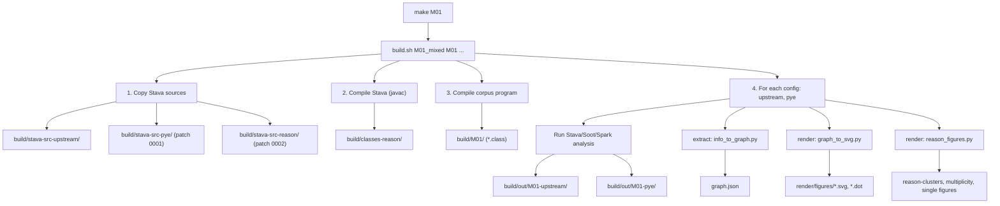
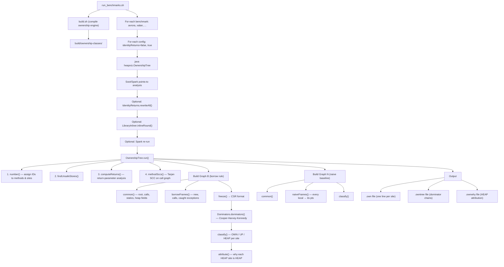
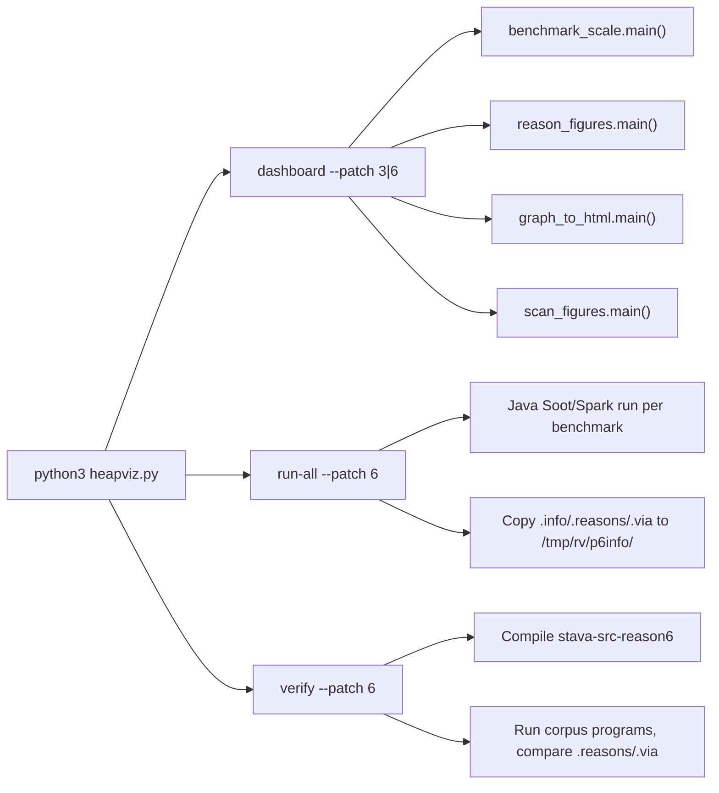
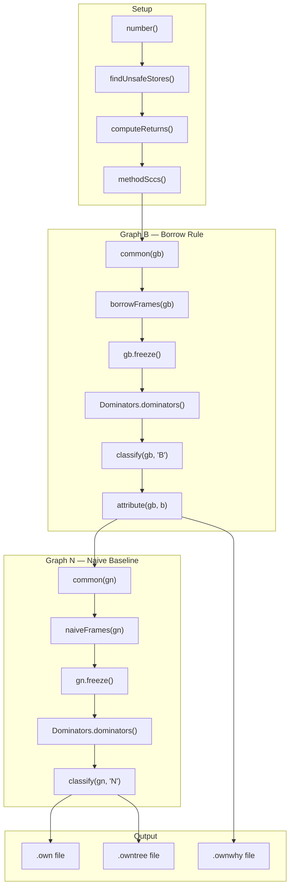
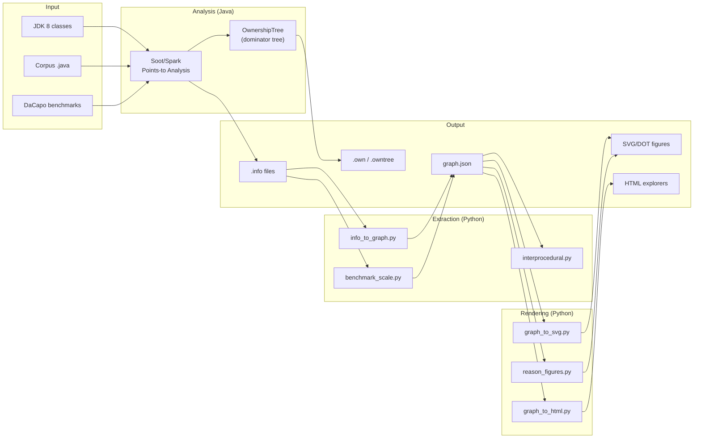

# HeapViz — Architecture & Control Flow

> **What this project does**: HeapViz is a static ownership analysis tool for Java programs.
> It runs Soot/Spark points-to analysis on DaCapo benchmarks, builds a dominator tree over the
> heap graph, and classifies every allocation site as **OWN** (owned by the allocating method),
> **UP** (owned by an ancestor in the call chain), or **HEAP** (globally reachable).

---

## 1. Directory Structure

```
heapviz/
├── build.sh              # Main build & analysis pipeline (compile → Soot → extract → render)
├── heapviz.py            # Unified Python CLI (dashboard, run-all, verify subcommands)
├── Makefile              # Make targets for corpus programs (M01, E01, etc.)
│
├── corpus/               # Micro-benchmark source files (M01, E01–E11, etc.)
│
├── patches/              # Stava source patches
│   ├── 0001-store-escape-off.patch
│   └── 0002-escape-reasons.patch
│
├── extract/              # Data extraction from Soot output
│   └── python/
│       ├── info_to_graph.py       # Converts .info files → graph.json
│       ├── benchmark_scale.py     # Scales extraction for DaCapo benchmarks
│       ├── interprocedural.py     # Inter-procedural PTG stitching
│       ├── escape_blast.py        # Escape-blast analysis
│       ├── reason_source_map.py   # Maps reasons to source locations
│       ├── source_index.py        # Source file indexer
│       └── ...
│
├── render/               # Visualization generation
│   └── python/
│       ├── graph_to_svg.py        # graph.json → SVG/DOT diagrams
│       ├── graph_to_html.py       # graph.json → interactive HTML explorer
│       ├── reason_figures.py      # Escape-reason cluster/multiplicity figures
│       └── source_dashboard.py    # Source-annotated dashboards
│
├── tools/                # Analysis tools and ownership tree
│   ├── java/
│   │   └── heapviz/               # Core Java analysis engine (see §3)
│   │       ├── OwnershipTree.java
│   │       ├── OwnershipGraph.java
│   │       ├── Dominators.java
│   │       ├── OwnershipResult.java
│   │       ├── IntList.java
│   │       ├── IdentityReturns.java
│   │       └── LibraryInliner.java
│   ├── python/                    # Python analysis scripts
│   │   ├── alloc_unit.py          # Allocation-unit analysis
│   │   ├── evidence_report.py     # Evidence report generation
│   │   ├── param_hubs.py          # Parameter hub detection
│   │   ├── viz_audit.py           # Visualization audit
│   │   └── ...
│   ├── scripts/                   # Bash helper scripts
│   │   └── ownership/
│   │       ├── build.sh           # Compiles the Java ownership engine
│   │       ├── verify.sh          # Runs manual verification tests (T1–T20)
│   │       └── run_benchmarks.sh  # Runs avrora/xalan/etc. ownership benchmarks
│   ├── data/
│   │   └── known_uninstrumented.json
│   └── archive/                   # Legacy phase-specific scripts (historical)
│
├── build/                # Build outputs (compiled classes, analysis results)
│   ├── classes-reason6/           # Compiled Stava (patched with escape reasons)
│   ├── ownership-classes/         # Compiled ownership engine (OwnershipTree + friends)
│   ├── out/                       # Analysis output per program (graph.json, etc.)
│   └── own/                       # Ownership tree outputs (.own, .owntree files)
│
└── render/figures/       # Generated SVG/DOT/HTML figures
```

---

## 2. End-to-End Control Flow

### 2.1 Primary Pipeline: `make M01` / `build.sh`

This is the main flow for analyzing a single corpus program (e.g., M01):



### 2.2 Ownership Analysis Pipeline: `run_benchmarks.sh`



### 2.3 Python CLI: `heapviz.py`



---

## 3. Java Ownership Engine — Class Responsibilities

### Core Classes (`tools/java/heapviz/`)

| Class | Lines | Responsibility |
|-------|-------|---------------|
| **OwnershipTree** | ~1050 | Main entry point and orchestrator. Runs Soot, numbers nodes, builds graphs, classifies sites, writes output. |
| **OwnershipGraph** | ~70 | Edge accumulator with deduplication. Freezes into CSR (Compressed Sparse Row) format for fast traversal. |
| **Dominators** | ~120 | Graph algorithms: Cooper-Harvey-Kennedy dominator tree, BFS domination check, witness path finder. |
| **OwnershipResult** | ~18 | Data class holding classification results: `idom[]`, `cls[]`, `region[]`, `owner[]`, `up[]`, `rec[]`. |
| **IntList** | ~12 | Growable `int[]` (like `ArrayList<Integer>` without boxing). |
| **IdentityReturns** | ~130 | Rewrites `x = y.m()` → `y.m(); x = y` when every target returns exactly that argument. Reduces graph noise. |
| **LibraryInliner** | ~220 | Copies JDK method bodies into the application's call graph so Spark can resolve their allocations. |

### Internal Flow of `OwnershipTree.run()`



---

## 4. Key Concepts

### Node Numbering
Every entity in the ownership graph gets a unique integer ID:
- **0** = `ROOT` (the universe entry point)
- **1** = `GLOBAL` (static fields, special Spark nodes)
- **2 .. 2+M-1** = methods (one per reachable method in the call graph)
- **2+M .. 2+M+S-1** = allocation sites (one per `new` expression Spark tracks)
- **2+M+S ..** = Unsafe store proxy nodes

### The Borrow Rule (Graph B vs Graph N)
- **Graph B** uses the *borrow rule*: a frame only gets an edge to an object if it actually *creates* it (`new`), receives it from a call that isn't parameter-derived, or catches it.
- **Graph N** is the naive baseline: every local in a method points to its entire Spark points-to set.
- The borrow rule makes Graph B much sparser, letting more sites be classified as OWN.

### Classification
For each allocation site, walk up the dominator tree to the nearest method:
- **OWN**: the nearest method *is* the allocating method → the object dies when that method returns
- **UP(k)**: the nearest method is *k* SCC hops above the allocator in the call graph
- **HEAP**: no method dominates the site (reachable from GLOBAL or ROOT directly)

---

## 5. Test & Verification Flow

### Quick Smoke Tests

| Command | What it tests | Time |
|---------|--------------|------|
| `./tools/scripts/ownership/build.sh` | Java compilation of the ownership engine | ~5s |
| `./tools/scripts/ownership/verify.sh T1` | Dynamic tree on a known heap (`D01.java`) | ~10s |
| `make M01` | Full pipeline on micro-benchmark M01 (compile → Soot → extract → render) | ~2 min |

### Benchmark Tests

| Command | What it tests | Time |
|---------|--------------|------|
| `ONLY="avrora" ./tools/scripts/ownership/run_benchmarks.sh` | Ownership tree on DaCapo avrora, both configs | ~4 min |
| `./tools/scripts/ownership/run_benchmarks.sh` | All 6 DaCapo benchmarks | ~30 min |

### Comprehensive Verification (`verify.sh`)

| Test | Description |
|------|-------------|
| **T1** | Dynamic tree on `D01.java`: dumps heap, checks dominator tree matches expected ownership |
| **T2** | Static tree on corpus `M01`: checks Lengauer-Tarjan = Cooper-Harvey-Kennedy |
| **T3** | Static tree on `E01`: known ground truth comparison |
| **T4–T14** | Stored-result tests: read `.own` files and check classification counts |
| **T20** | Full avrora re-run: checks output matches stored baseline (slow) |

### Expected Test Output (for regression checking)

**`verify.sh T1`** should print:
```
check: Lengauer-Tarjan and Cooper-Harvey-Kennedy differ on 0 nodes
```

**`run_benchmarks.sh` (avrora)** should print:
```
[ownership] check B: 40 application sites, 0 failures
[ownership] check N: 40 application sites, 0 failures
```

---

## 6. Data Flow Diagram



